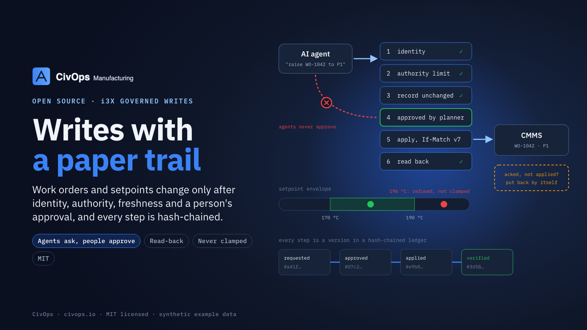

# i3X governed writes

A write governor for [CESMII i3X](https://www.cesmii.org/) servers and agent gateways. A person, a system or an AI agent asks for a change to a work order in a CMMS (tier **W1**) or to a setpoint on the plant floor (tier **W2**); nothing reaches the target until the request has passed every check, and every step is a version in a hash-chained ledger.



It implements §7 of the [i3X Nexus Profile](https://github.com/LNS-Research/i3x-nexus-profile) (LNS Research). `NX-nn` in the source comments are that profile's requirement ids.

## The lifecycle

```
requested ──approve──▶ approved ──apply (If-Match)──▶ applied ──read back──▶ verified
    │                     │                              │
    ├─ reject ─▶ rejected  ├─ record moved ─▶ rejected     └─ mismatch ─▶ compensated ─▶ rolled_back
    └─ timeout ─▶ expired  └─ system 4xx ─▶ rejected (a 5xx keeps the approval and retries)
```

Each arrow is one new ledger version written by whoever caused it, so a request's version history is its audit trail.

| Check | Rule |
|---|---|
| Identity | Every write carries a principal: a person, an agent or a service |
| Idempotency | `idempotencyKey` is required; a retried request is the same request |
| Authority | An authority limit per site and exception type: owner role, approver roles, delegated limit, materiality threshold, boundary triggers |
| Escalation | escalates when exposure ≥ materiality or any boundary trigger fires; `no_decision_right` when no limit exists (the request is rejected); `exposure_unknown` when none is stated; otherwise stays local. Above the delegated limit, or escalated, or unknown exposure: owner only |
| Approval | A person or service holding an approver role. **Never the requester. Never an agent**, whatever roles it holds. W2 setpoints: a named **person**, every time |
| Irreversible | `reversible: false` needs approval one level above the owner (`aboveOwnerRole`), and can never be rolled back |
| Freshness | Applied only if the record is still at the version the request was raised against (`If-Match`). If it moved, rejected: the newer value stands |
| Read-back | The target is read after the write. A mismatch is compensated at once with the recorded prior value, no approval needed, because the approved state never existed |
| Rollback | A new request that `compensates` a verified one, approved like any other; the original stays verified |
| Expiry | W1 requests expire unapproved after 4 h, W2 after 15 min |
| Restart | `resume()` finishes interrupted requests: an approved request is applied once; one whose apply reached the system but was never recorded is recorded, not applied again |

### Setpoints (W2)

A setpoint is one more system of record, through the same lifecycle. Each point declares an envelope (`min`, `max`, `maxStep` from the current value, or a list of `allowed` states). A value outside it is **rejected, never clamped**, both when requested and again when applied. A point not reading Good is never written. W2 can be suspended (for example while redundancy is degraded): new requests are refused, approved ones are held and applied when it clears.

## Use

Requires Node 22 or later. No runtime dependencies. The package ships TypeScript source; run it with `tsx` or your own build.

```ts
import { Governor, Ledger, CmmsRestAdapter, SystemProjection, SetpointAdapter, envelopeViolation, SETPOINT_SYSTEM } from "./src/index";

const cmms = new CmmsRestAdapter("cmms", "https://cmms.example/api", process.env.CMMS_TOKEN);
const projection = new SystemProjection([{ id: "cmms", typeId: "WorkOrder", adapter: cmms }]);
await projection.start();                                   // polls; projection.objects() for your address space

const setpoints = new SetpointAdapter(new Map([
  ["line2:bowl-temp-sp/value", { envelope: { min: 55, max: 70, maxStep: 3 },
    read: () => cache.get("line2:bowl-temp-sp/value"),    // { value, quality } from your value cache
    write: (v) => opcua.write("ns=2;s=Line2.BowlTempSP", v) }],
]));

const governor = new Governor({
  ledger: () => ledger,                                     // new Ledger("data/ledger.jsonl")
  site: "example-riverside",
  resolveTarget: (elementId) => projection.resolve(elementId),
  resolveSetpoint: (id, field) => setpoints.has(`${id}/${field}`) ? { system: SETPOINT_SYSTEM, recordId: `${id}/${field}` } : null,
  envelopeCheck: (attr, proposed, current) => envelopeViolation(setpoints.envelopeOf(attr) ?? {}, proposed, current),
  adapters: new Map([["cmms", cmms], [SETPOINT_SYSTEM, setpoints]]),
  limits: () => authorityLimitRecords(),                    // [{ elementId, value: AuthorityLimit }]
});

// Writes to the W1 / W2 intake become requests; writes to a request are decisions.
const r = await governor.request(principal, body, "W1");    // body: { idempotencyKey, target, proposed, exceptionType, exposureUsd, … }
await governor.decide(approver, r.id, { decision: "approve", comment: "fits the window" });
setInterval(() => governor.resume(), 30_000);               // expiries, retries, interrupted requests
```

An i3X server typically exposes the intakes as the writable elements `nexus:intake:W1` and `nexus:intake:W2`, serves each request (`nexus:wr:…`) as a record whose history is `ledger.history(id)`, and refuses direct writes to projected records with a pointer to the intake. `examples/agent-reprioritises.ts` runs the whole W1 flow against the synthetic CMMS.

### Adapters

`SystemAdapter` is four methods: `list`, `read`, `apply(recordId, fields, ifVersion)`, and that is all; compensation is just another apply. `CmmsRestAdapter` speaks a plain REST work-order API (`GET /workorders`, `GET/PATCH /workorders/:id` with `If-Match`, `POST /workorders`), the shape most CMMS and MES products expose. `src/synthetic-cmms.ts` serves it with fictional work orders, and can be told to acknowledge writes without applying them or to fail them (`npm run cmms` starts it on :8430).

### Ledger

`Ledger` is a JSONL file (or memory only), replayed on start, every version chained to the one before by SHA-256 over canonical JSON. `scripts/verify-ledger.ts <file>` checks the chain and lists where each request ended up, and fails if anything was applied without an approval. A redundant pair needs a shared, fenced ledger instead: implement `GovernorLedger` (four methods) over your database, append only from the current governor, check that inside the append, and dedupe on the per-transition idempotency key the governor passes; throw `NotLeaderError` from a fenced append.

## Test

```bash
npm test          # governor against the synthetic CMMS over HTTP, a file ledger, and an in-memory setpoint device
npm run typecheck
```

15 tests, including a 300-step randomised property run (nothing applied without a valid approval, from someone other than the requester and not an agent, in order), a 10,000-value setpoint fuzz around an envelope (none outside accepted), and restarts at both dangerous moments (approved but not applied; applied but not recorded). No database, device or network beyond localhost. All data is synthetic.

## License

MIT. See [LICENSE](LICENSE). From [CivOps](https://civops.io).
